# Atelier OAuth 2.0 / OpenID Connect
### Sécuriser une application React + Spring Boot avec Keycloak

Module : Sécurité des systèmes distribués

Cette application de **gestion des demandes** est authentifiée par **Keycloak** (OpenID Connect, flux *Authorization Code* avec **PKCE**). L'API Spring Boot valide les *Access Tokens* JWT et applique les autorisations selon les rôles **USER** et **ADMIN**.

---

## 1. Architecture

| Composant | Technologie | Port | Dossier |
|---|---|---|---|
| Serveur d'identité | Keycloak 26.8.1 (Docker) | 8080 | `docker-compose.yml` |
| API sécurisée (Resource Server) | Spring Boot 3.5 / Java 17+ | 8081 | `demandes-api/` |
| Frontend (client public) | React 18 + Vite + keycloak-js | 5173 | `demandes-front/` |

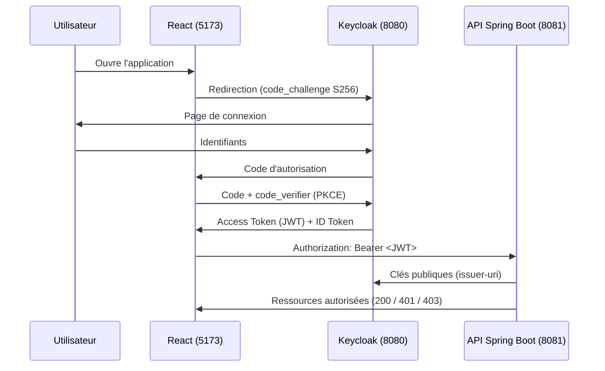

**Rôles des acteurs :**
- Keycloak : *Authorization Server* et *OpenID Provider*.
- React : client OAuth 2.0 / OIDC **public** (pas de secret, d'où PKCE).
- Spring Boot : *Resource Server* qui valide la signature, l'émetteur et l'expiration du JWT.

## 2. Prérequis

Docker Desktop, Java 17 ou 21 (JDK 23 fonctionne aussi, ce projet n'utilise pas Lombok), Maven ou IntelliJ, Node.js LTS, un navigateur et Postman.

## 3. Lancement

### 3.1 Keycloak
```powershell
docker compose up -d
docker compose logs -f keycloak
```
Console d'administration : http://localhost:8080 (`admin` / `admin`, **uniquement pour le TP local**).

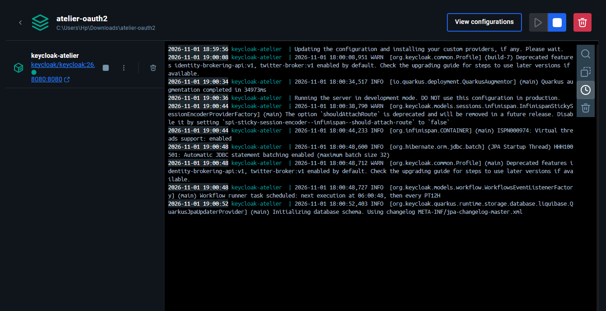

### 3.2 Configuration de Keycloak (à faire une seule fois)

**a) Realm `enset-realm`** : sélecteur de realm → *Create realm*.

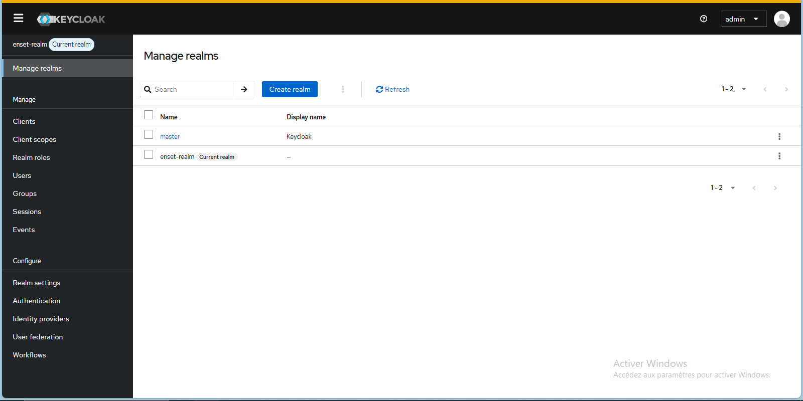

**b) Client `react-client`** : *Clients → Create client*

| Paramètre | Valeur |
|---|---|
| Client type | OpenID Connect |
| Client ID | `react-client` |
| Client authentication | **Off** (client public) |
| Standard flow | **On** |
| Implicit flow | Off |
| Direct access grants | Off |
| Root URL / Home URL | `http://localhost:5173/` |
| Valid redirect URIs | `http://localhost:5173/*` |
| Web origins | `http://localhost:5173` |
| PKCE Code Challenge Method (onglet *Advanced*) | `S256` |

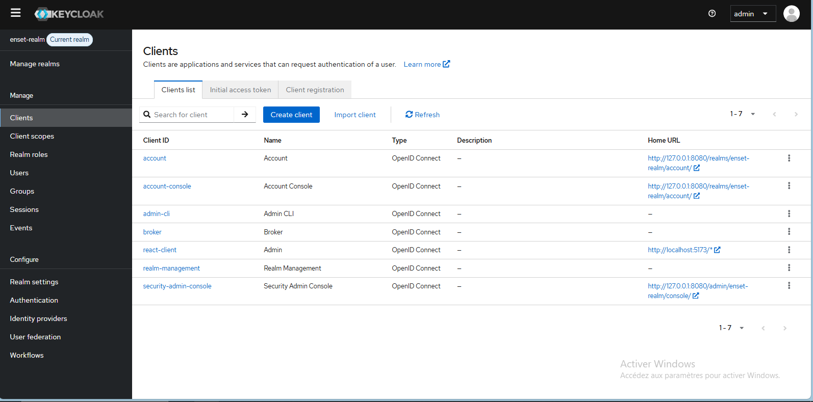

> **Important** : *Web origins* doit être exactement `http://localhost:5173`. Sinon le navigateur bloque l'échange du code contre le token (erreur CORS sur `/protocol/openid-connect/token`).

**c) Rôles** : *Realm roles → Create role* : `USER` et `ADMIN` (rôles simples, non composites).

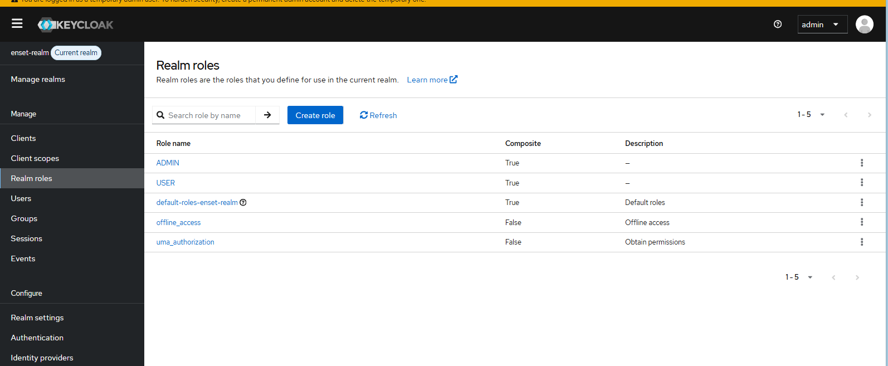

**d) Utilisateurs** : *Users → Add user*

| Utilisateur | Mot de passe | Rôles |
|---|---|---|
| `alice` | `alice123` | USER |
| `bob` | `bob123` | USER, ADMIN |

Pour chacun : remplir email, prénom et nom, puis *Credentials → Set password* avec **Temporary = Off**, puis *Role mapping → Assign role*.

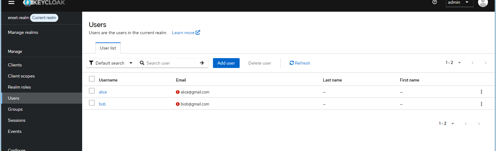

> Ce sont des **Realm roles** : ils se retrouvent dans le JWT sous `realm_access.roles`.

Vérification : http://localhost:8080/realms/enset-realm/.well-known/openid-configuration doit afficher du JSON.

### 3.3 Backend Spring Boot
Dans IntelliJ : ouvrir `demandes-api` comme projet Maven puis lancer `DemandesApiApplication`. Ou en terminal :
```powershell
cd demandes-api
mvn spring-boot:run
```
Keycloak doit être démarré **avant** l'API (lecture de l'`issuer-uri` au démarrage). Test : http://localhost:8081/api/public

### 3.4 Frontend React
```powershell
cd demandes-front
npm install
npm run dev
```
Ouvrir **http://localhost:5173** (pas `127.0.0.1`) : redirection automatique vers Keycloak.

## 4. Le backend (`demandes-api`)

`application.properties` :
```properties
server.port=8081
spring.security.oauth2.resourceserver.jwt.issuer-uri=http://localhost:8080/realms/enset-realm
```
Spring découvre les clés publiques du realm et vérifie la **signature**, l'**émetteur** et la **validité temporelle** de chaque jeton.

**`SecurityConfig`**
- `oauth2ResourceServer` : l'API accepte des Access Tokens JWT.
- `JwtAuthenticationConverter` : transforme `realm_access.roles` en autorités `ROLE_USER` / `ROLE_ADMIN`.
- CORS : autorise uniquement `http://localhost:5173`.

**`DemandeController`** : le propriétaire d'une demande est le `sub` du JWT (`jwt.getSubject()`), jamais une valeur envoyée par React. Les demandes sont stockées en mémoire (elles disparaissent au redémarrage).

| Endpoint | Accès |
|---|---|
| `GET /api/public` | public |
| `GET /api/profil` | authentifié (id + username lus dans le JWT) |
| `GET /api/demandes`, `POST /api/demandes` | USER ou ADMIN (ses propres demandes) |
| `GET /api/admin/demandes` | ADMIN |
| `PATCH /api/admin/demandes/{id}` | ADMIN (`EN_ATTENTE`, `VALIDEE`, `REFUSEE`) |

## 5. Le frontend (`demandes-front`)

| Fichier | Rôle |
|---|---|
| `src/keycloak.js` | Configuration (url, realm `enset-realm`, client `react-client`) |
| `src/main.jsx` | `keycloak.init({ onLoad: 'login-required', pkceMethod: 'S256' })` puis affichage de l'application |
| `src/api.js` | `updateToken(30)` puis appel de l'API avec `Authorization: Bearer <token>` |
| `src/components/Layout.jsx` | Barre latérale, barre du haut, déconnexion |
| `src/pages/*` | Vue d'ensemble, Mes demandes, Nouvelle demande, Administration, Profil |

Le jeton reste **en mémoire** (keycloak-js) : il n'est jamais copié dans `localStorage`. Masquer la page Administration dans React n'est qu'un confort d'affichage : **la protection réelle est dans Spring Security**.

## 6. Résultats

### Bob (USER + ADMIN)
Vue d'ensemble et statistiques :

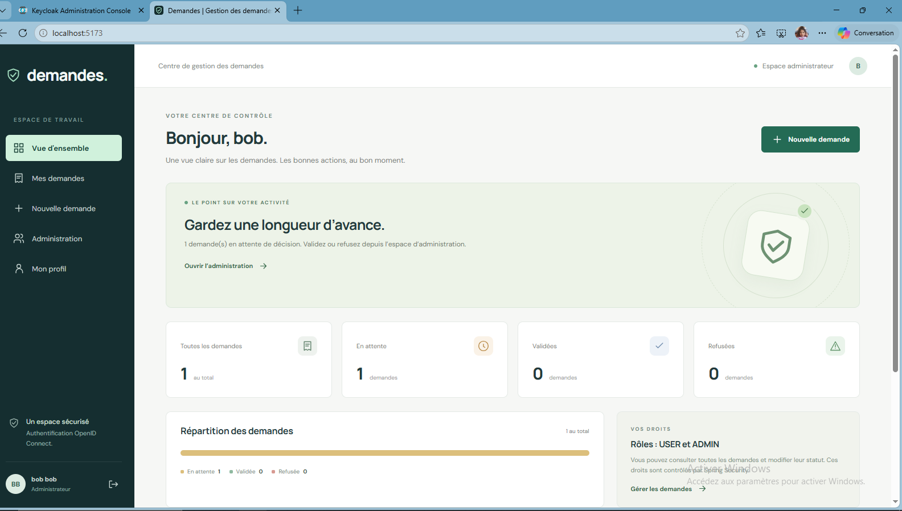

Profil lu depuis le JWT (`sub`, `preferred_username`, rôles, `iss`, `iat`, `exp`) :

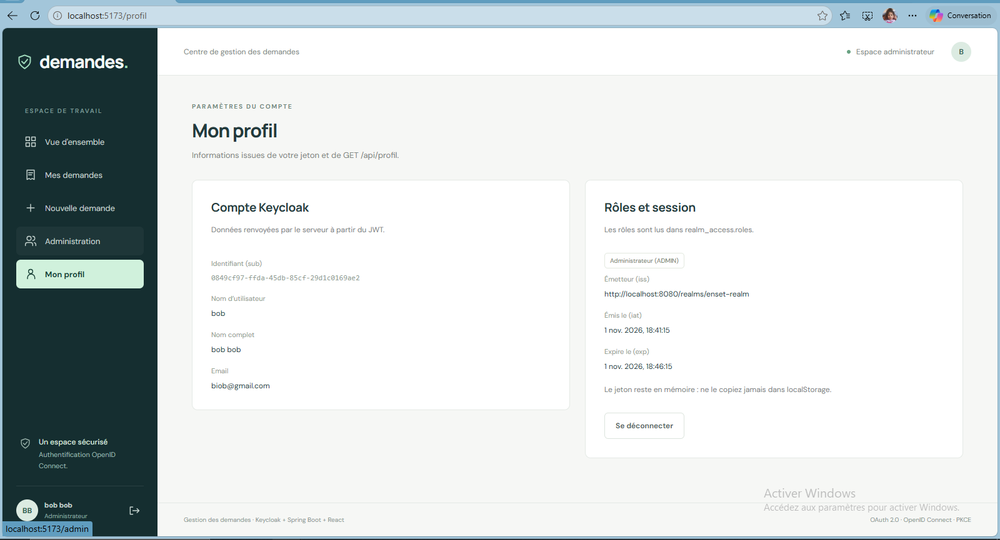

Espace administrateur : toutes les demandes, boutons **Valider** et **Refuser** :

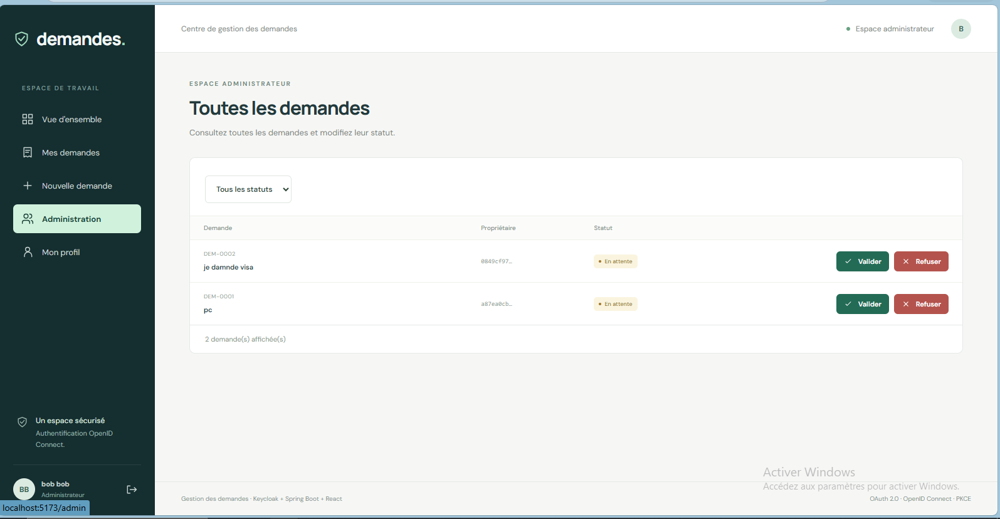

### Alice (USER)
Création d'une demande (pas de menu Administration) :

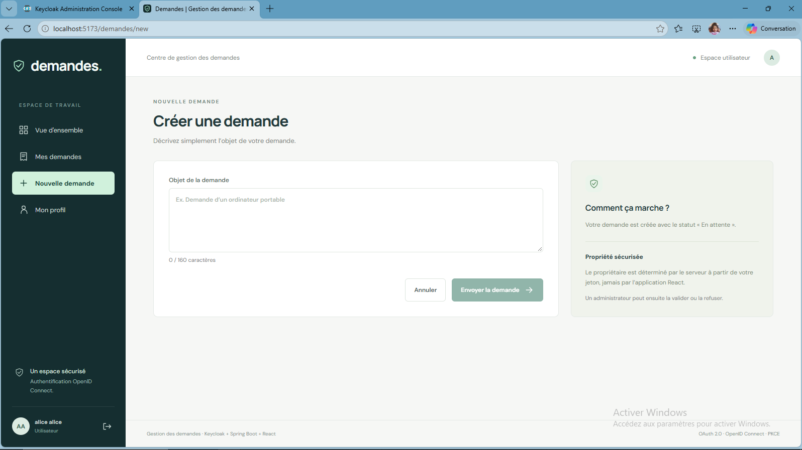

Suivi de ses demandes : la demande a été validée par l'administrateur.

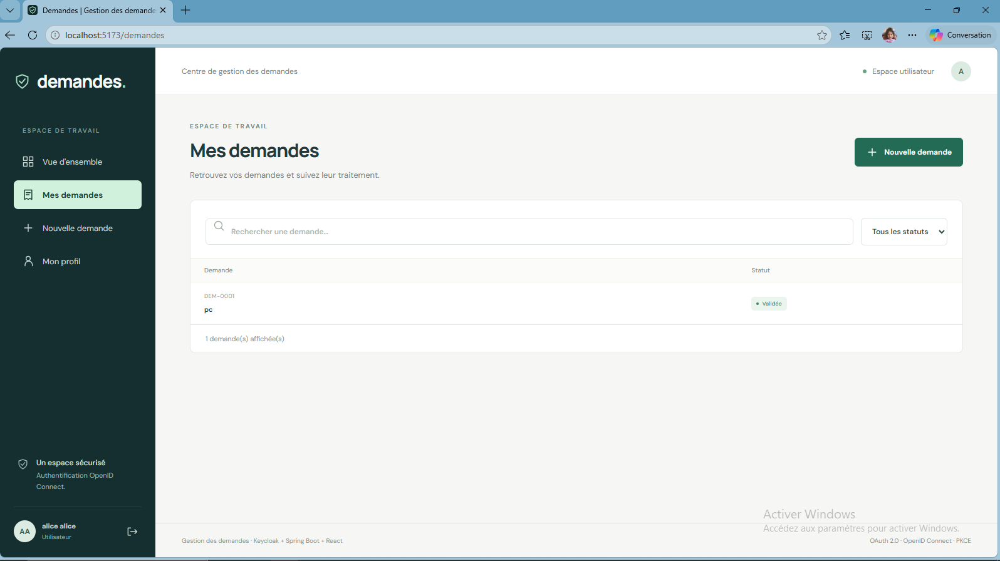

## 7. Tests de sécurité

Pour Postman : se connecter dans le navigateur, ouvrir *DevTools → Network*, copier le jeton de l'en-tête `Authorization: Bearer ...` d'une requête vers `localhost:8081` (le jeton expire vite, le recopier si besoin). **Ne jamais publier un vrai jeton.**

| # | Test | Résultat attendu |
|---|---|---|
| 1 | Connexion alice : panneau Administration absent, création et consultation OK | OK |
| 2 | Connexion bob : panneau Administration visible, validation possible | OK |
| 3 | Requête `GET /api/demandes` dans l'onglet Network | En-tête `Authorization: Bearer eyJ...` |
| 4 | `GET /api/demandes` sans token (Postman) | **401** |
| 5 | `GET /api/admin/demandes` avec le token d'alice | **403** |
| 6 | `GET /api/admin/demandes` avec le token de bob | **200** |
| 7 | Token modifié d'un caractère | **401** |
| 8 | `GET /api/profil` avec un token valide | id + username |

## 8. Travail supplémentaire réalisé

1. **Bouton Refuser** : requête `PATCH` avec le statut `REFUSEE`, réservée au rôle ADMIN.
2. **Endpoint `GET /api/profil`** : retourne l'identifiant (`sub`) et le nom d'utilisateur (`preferred_username`) extraits du JWT.
3. **Tests de sécurité** : voir le tableau ci-dessus.


## 9. Notes de sécurité

- `admin/admin` et `start-dev` sont réservés au TP local.
- Ne jamais publier un Access Token réel.
- JWT est un **format** de jeton, OAuth 2.0 un **framework d'autorisation**, OpenID Connect une **couche d'authentification** : ils sont complémentaires.
- L'Access Token sert à appeler l'API ; l'ID Token n'est pas destiné à autoriser les appels à l'API.
